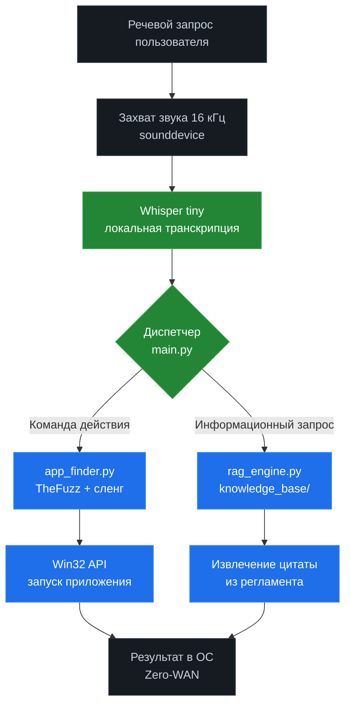
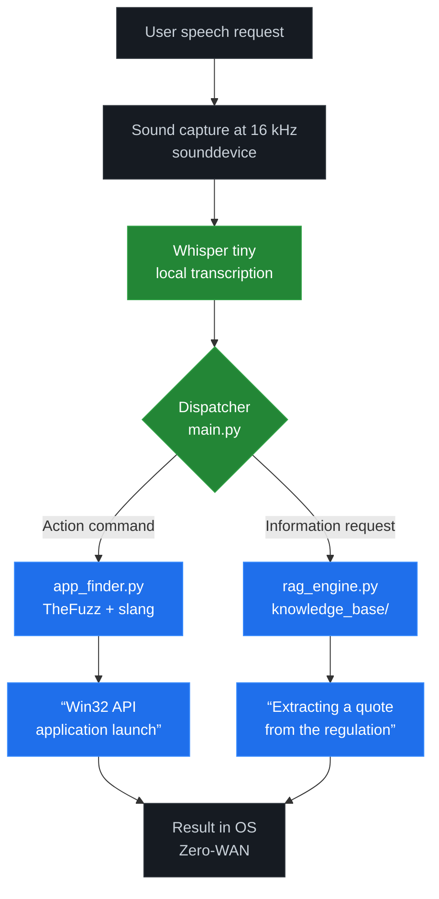

# Информатика

## Данный репразиторий предназначен для хранения практических работ по Предметам МДК/ОАиП/Ниже — **сжатый вариант примерно на 5 страниц** при оформлении в Word: **Times New Roman, 14, интервал 1,0, поля 2 см, абзацный отступ 1,25 см, выравнивание по ширине, автоперенос, без нумерации страниц**.  
Название файла лучше сделать: **Иванов_Проектирование и Инфраструктурные.docx**

Рисунок 1 нужно вставить отдельной картинкой, например из Mermaid Live Editor. Код схемы — в конце.

---

*Направление: Резилиентность социальной инфраструктуры и демографическая устойчивость регионов*  
УДК 004.89:332.14

**ПРОЕКТИРОВАНИЕ И ИНФРАСТРУКТУРНЫЕ ЭФФЕКТЫ ЛОКАЛЬНОГО АССИСТИВНОГО КОМПЛЕКСА «NEXUS ASSIST» В УСЛОВИЯХ ДЕМОГРАФИЧЕСКИХ ВЫЗОВОВ**

Иванов А.С.  
студент, Липецкий филиал Финуниверситета, г. Липецк  
Научный руководитель: Николаев В.П.  
к.э.н., доцент, Липецкий филиал Финуниверситета, г. Липецк

*Аннотация:* В статье проектируется локальный ассистивный программный комплекс «Nexus Assist» для операционной системы Windows в условиях дефицита трудовых ресурсов, старения населения и необходимости цифровой инклюзии граждан с ограниченными возможностями здоровья. Актуальность исследования обусловлена зависимостью облачных голосовых сервисов от интернет-канала, рисками утечки персональных данных и слабой адаптацией к разговорному сленгу. Цель работы — разработать архитектуру автономного голосового помощника и оценить его инфраструктурные эффекты. Задачи включают описание целевых групп пользователей, сквозного конвейера обработки речи на базе OpenAI Whisper в конфигурации tiny, нечеткого сопоставления TheFuzz, бессерверного RAG-поиска по локальной нормативной документации и изоляции кэша через переменные окружения. Сделан вывод о том, что концепции Zero-Click и Zero-WAN повышают доступность рабочих мест, укрепляют резилиентность социальной инфраструктуры и снижают информационные риски регионального управления.

*Ключевые слова:* региональное управление, демографическая устойчивость, ассистивные технологии, цифровая инклюзия, OpenAI Whisper, нечеткий поиск, RAG, Zero-Click, Zero-WAN, информационная безопасность.

**DESIGN AND INFRASTRUCTURAL EFFECTS OF THE LOCAL ASSISTIVE COMPLEX “NEXUS ASSIST” UNDER DEMOGRAPHIC CHALLENGES**

Ivanov A.S.  
Student, Lipetsk Branch of the Financial University, Lipetsk  
Scientific supervisor: Nikolaev V.P.  
Candidate of Economic Sciences, Associate Professor, Lipetsk Branch of the Financial University, Lipetsk

*Abstract:* The paper designs a local assistive software complex “Nexus Assist” for the Windows operating system under labor shortages, population aging, and the need for digital inclusion of people with disabilities. The relevance is caused by the dependence of cloud voice services on internet connectivity, personal data leakage risks, and poor adaptation to conversational slang. The aim is to develop the architecture of an autonomous voice assistant and assess its infrastructural effects. The objectives include describing target user groups, the end-to-end speech processing pipeline based on OpenAI Whisper in the tiny configuration, fuzzy matching using TheFuzz, serverless RAG retrieval from local regulatory documents, and cache isolation through environment variables. It is concluded that the Zero-Click and Zero-WAN concepts improve workplace accessibility, strengthen social infrastructure resilience, and reduce information risks in regional governance.

*Keywords:* regional governance, demographic sustainability, assistive technologies, digital inclusion, OpenAI Whisper, fuzzy search, RAG, Zero-Click, Zero-WAN, information security.

Регионы России работают в условиях демографического сжатия: численность трудоспособного населения сокращается, доля пожилых граждан растет, а нагрузка на органы местного самоуправления, многофункциональные центры, социальные учреждения и первичное звено управления увеличивается [1]. В такой ситуации цифровизация перестает быть вопросом комфорта и становится фактором устойчивости социальной инфраструктуры. Особенно важно, чтобы технологии оставались доступными для людей с ограниченными возможностями здоровья и не требовали постоянного стабильного интернет-соединения [3].

Казалось бы, голосовые помощники уже могут решить эту задачу. Однако облачные сервисы общего назначения плохо подходят для ведомственной среды. Они передают аудио и служебные запросы во внешние центры обработки данных, создают риски для персональных данных и конфиденциальной информации, а также становятся неработоспособными при сбоях связи [2]. Кроме того, такие системы часто ожидают формальных команд, тогда как реальный пользователь говорит просто: «открой ворд», «нужен эксель», «найди регламент по субсидиям». Именно поэтому был спроектирован локальный комплекс «Nexus Assist», работающий внутри операционной системы Windows без исходящего сетевого трафика.

Цель исследования — разработать архитектуру автономного ассистивного комплекса и показать его эффект для региональной инфраструктуры. Практический сценарий достаточно прост: специалист МФЦ в небольшом городе голосом запускает нужную программу, запрашивает пункт инструкции из локальной базы документов и получает ответ даже при нестабильном интернете. Для пользователя с нарушениями моторики верхних конечностей это означает режим Zero-Click: минимум физических действий с клавиатурой и мышью, максимум управления голосом.

Комплекс реализован на Python 3.12 и состоит из нескольких модулей, представленных в репозитории проекта [4]. Модуль whisper_listener.py захватывает звук с частотой 16 кГц через библиотеку sounddevice и передает аудиосигнал в локальную модель OpenAI Whisper конфигурации tiny [6]. Модуль app_finder.py отвечает за запуск приложений: он сравнивает распознанную фразу со списком программ, ярлыков и синонимов через библиотеку TheFuzz [7]. Модуль rag_engine.py выполняет поиск по папке knowledge_base/, где хранятся регламенты, инструкции, памятки и внутренние положения в форматах .txt и .md [5]. Диспетчер main.py определяет тип запроса, вызывает нужный модуль и взаимодействует с Win32 API. Отдельно настроена изоляция кэша: переменные окружения перенаправляют временные файлы на выделенный накопитель, например F:\cache, что снижает риск переполнения системного диска и упрощает технический аудит.

Сквозное время реакции системы можно представить как сумму основных этапов (формула 1):

T_ответа = T_захвата + T_транскрипции + T_маршрутизации + T_исполнения ≤ 1,0 с. (1)

Такой ориентир достижим для коротких команд на обычных офисных компьютерах, поскольку модель Whisper tiny не требует обязательного наличия дискретного графического процессора и не тратит время на обмен данными с внешним сервером. Структурно-функциональная схема комплекса приведена на рис. 1.

Выбор модели tiny — это осознанный компромисс между скоростью и точностью. Компактная модель может ошибаться в шумной обстановке или при сложной терминологии, но эта слабость компенсируется вторым уровнем обработки — нечетким сопоставлением. Если Whisper вместо «Microsoft Word» распознает «макрософт ворд», «майкрософт вард» или просто «ворд», TheFuzz находит ближайший вариант по словарю и адаптивному сленговому конфигу. Такой подход важен потому, что в реальной работе пользователь не должен переучиваться под машину: цифровая система должна понимать человека.

Второй контур комплекса — знаниевый. Локальный RAG-поиск не генерирует свободный ответ через внешнюю большую языковую модель, а извлекает релевантный фрагмент из подготовленного документа. Для государственного и социального сектора это принципиально: сотруднику нужен не творческий пересказ, а точная цитата регламента, срок оказания услуги, основание отказа или ссылка на пункт инструкции. Поскольку корпус документов находится на рабочей станции, запрос не покидает периметр организации, а качество ответа зависит от дисциплины ведения локальной базы знаний.

Сравнение облачных и локальных ассистивных решений показывает, что «Nexus Assist» смещает акцент с универсальности на управляемость, автономность и безопасность (табл. 1).

Таблица 1 — Сравнительная характеристика облачных и локальных ассистивных решений

| Критерий | Облачные ассистенты | «Nexus Assist» | Значение для региональной инфраструктуры |
|---|---|---|---|
| Работа без интернета | Зависит от внешнего канала | Сохраняет основные функции | Повышает устойчивость сервисов в периферийных территориях [1] |
| Обработка персональных данных | Передача во внешние сервисы | Zero-WAN, локальная обработка | Снижает риски по Федеральному закону № 152-ФЗ [2] |
| Доступность для пользователей с ОВЗ | Ограничена интерфейсом и связью | Zero-Click, голосовое управление | Поддерживает цифровую инклюзию [3] |
| Понимание разговорного сленга | Часто требует формальных команд | TheFuzz + адаптивный словарь | Уменьшает ошибки и повторные запросы [7] |
| Поиск по нормативным документам | Как правило, внешний или отсутствует | Локальный RAG по knowledge_base/ | Ускоряет доступ к регламентам и инструкциям [5] |

| Criterion | Cloud Assistants | “Nexus Assist” | Significance for regional infrastructure |
|---|---|---|---|
| Operation without the internet | Depends on an external channel | Retains basic functions | Increases service resilience in peripheral areas [1] |
| Personal data processing | Transfer to external services | Zero‑WAN, local processing | Reduces risks under Federal Law No. 152‑FZ [2] |
| Accessibility for users with disabilities | Limited by interface and connectivity | Zero-Click, voice control | Supports digital inclusion [3] |
| Understanding of colloquial slang | Often requires formal commands | TheFuzz + adaptive dictionary | Reduces errors and repeated requests [7] |
| Search by regulatory documents | Typically external or absent | Local RAG on knowledge_base/ | Speeds up access to regulations and instructions [5] |

Примечание. Составлено авторами по [2; 3; 5; 7].

Инфраструктурный эффект проекта состоит не в замене сотрудников, а в снижении трения повседневной работы. Голосовое открытие приложений экономит секунды, но в масштабе приема граждан эти секунды превращаются в часы свободного времени. Локальный поиск по инструкциям уменьшает количество уточняющих обращений, снижает вероятность ошибки и помогает быстрее ориентироваться в нормативных документах. Для региона это означает более устойчивое первичное звено управления: меньше зависимости от внешних облачных провайдеров, меньше рисков при сбоях связи, больше возможностей для создания инклюзивных рабочих мест.

Вместе с тем решение не является универсальным. Модель Whisper tiny требует достаточно качественного микрофона и умеренного уровня шума, RAG-поиск эффективен только при актуальной базе документов, а сленговый словарь необходимо периодически пополнять. Тем не менее эти ограничения носят эксплуатационный характер. Их можно снижать настройкой порогов нечеткого сопоставления, обучением пользователей и постепенным переходом на более мощные локальные модели без нарушения принципа Zero-WAN.

Таким образом, «Nexus Assist» показывает, что суверенная ассистивная технология может быть простой, полезной и безопасной одновременно. Локальная обработка речи, адаптивное понимание сленга и автономный поиск по документам превращают голосовой интерфейс из вспомогательной функции в элемент устойчивой социальной инфраструктуры. В условиях демографических вызовов именно такие решения способны повысить доступность цифровых сервисов, снизить нагрузку на персонал и укрепить управленческую резилиентность регионов.

Литература

1. Демографическая ситуация в Российской Федерации [Электронный ресурс] / Федеральная служба государственной статистики. – URL: https://rosstat.gov.ru/folder/12799 (дата обращения: 25.09.2026).

2. О персональных данных : Федеральный закон от 27.07.2006 № 152-ФЗ [Электронный ресурс] // СПС КонсультантПлюс. – URL: https://www.consultant.ru/document/cons_doc_LAW_61801/ (дата обращения: 25.09.2026).

3. О социальной защите инвалидов в Российской Федерации : Федеральный закон от 24.11.1995 № 181-ФЗ [Электронный ресурс] // СПС КонсультантПлюс. – URL: https://www.consultant.ru/document/cons_doc_LAW_8609/ (дата обращения: 25.09.2026).

4. Information : репозиторий локального ассистивного комплекса Nexus Assist [Электронный ресурс] // GitHub. – URL: https://github.com/lstsaku/Information (дата обращения: 25.09.2026).

5. Lewis, P. Retrieval-Augmented Generation for Knowledge-Intensive NLP Tasks [Электронный ресурс] / P. Lewis, E. Perez, A. Piktus [и др.] // arXiv.org. – 2020. – URL: https://arxiv.org/abs/2005.11401 (дата обращения: 25.09.2026).

6. Radford, A. Robust Speech Recognition via Large-Scale Weak Supervision [Электронный ресурс] / A. Radford, J. W. Kim, T. Xu [и др.] // arXiv.org. – 2022. – URL: https://arxiv.org/abs/2212.04356 (дата обращения: 25.09.2026).

7. TheFuzz : fuzzy string matching for Python [Электронный ресурс] // GitHub. – URL: https://github.com/seatgeek/thefuzz (дата обращения: 25.09.2026).

---

Mermaid-код для Рисунка 1

Вставь в Mermaid Live Editor, сохрани как PNG и вставь в Word под подписью:

Рисунок 1 — Структурно-функциональная схема локального ассистивного комплекса «Nexus Assist»

import tkinter as tk
from tkinter import messagebox

def open_login(root, open_main):
    root.title("Авторизация")
    root.geometry("300x220")

    # Поле логина
    tk.Label(root, text="Введите логин:").pack(pady=3)
    login_entry = tk.Entry(root)
    login_entry.pack(pady=3)

    # Поле пароля
    tk.Label(root, text="Введите пароль:").pack(pady=3)
    pass_entry = tk.Entry(root, show="*")
    pass_entry.pack(pady=3)

    # Надпись для ошибки (пока пустая)
    error_label = tk.Label(root, text="", fg="red")
    error_label.pack(pady=8)

    # Функция проверки при нажатии на кнопку
    def check_login():
        login = login_entry.get()
        password = pass_entry.get()

        if (login == "admin" or login == "админ") and password == "1234":
            error_label.config(text="")
            open_main()  # Открываем главное окно
        else:
            error_label.config(text="Ошибка: неверный логин или пароль!")
            messagebox.showerror("Ошибка", "Неверный логин или пароль!")

    # Кнопка входа
    tk.Button(root, text="Войти", command=check_login).pack(pady=5)

import tkinter as tk
from auth.login_window import open_login
from main_app.orders_window import OrdersWindow

def start_main():
    OrdersWindow(tk.Toplevel())

root = tk.Tk()
open_login(root, start_main)
root.mainloop()

import tkinter as tk
from tkinter import ttk

class OrdersWindow:
    def __init__(self, root):
        self.root = root
        self.root.title("Работа с заказами")
        self.root.geometry("870x430")
        self.root.resizable(False, False)

        # Верхняя часть: Фильтр и Поиск
        top_frame = tk.Frame(root, padx=20, pady=15)
        top_frame.pack(fill=tk.X)

        # Первая строка: Выберите заказчика + кнопки
        tk.Label(top_frame, text="Выберите заказчика", font=("Comic Sans MS", 10)).grid(
            row=0, column=0, sticky="w", padx=(0, 15), pady=6
        )
        customer_cb = ttk.Combobox(
            top_frame,
            values=['ООО "Кинотеатр Квант"', 'ООО "Ассоль"', 'ООО "Поставка"'],
            width=25,
            font=("Comic Sans MS", 10)
        )
        customer_cb.set('ООО "Кинотеатр Квант"')
        customer_cb.grid(row=0, column=1, padx=5, pady=6)

        tk.Button(top_frame, text="Фильтровать", font=("Comic Sans MS", 9), width=13, relief="solid", bd=1).grid(
            row=0, column=2, padx=10, pady=6
        )
        tk.Button(top_frame, text="Показать все", font=("Comic Sans MS", 9), width=13, relief="solid", bd=1).grid(
            row=0, column=3, padx=5, pady=6
        )

        # Вторая строка: Введите строку поиска + кнопка Найти
        tk.Label(top_frame, text="Введите строку поиска", font=("Comic Sans MS", 10)).grid(
            row=1, column=0, sticky="w", padx=(0, 15), pady=6
        )
        search_entry = tk.Entry(top_frame, width=28, font=("Comic Sans MS", 10), relief="solid", bd=1)
        search_entry.grid(row=1, column=1, padx=5, pady=6)

        tk.Button(top_frame, text="Найти", font=("Comic Sans MS", 9), width=13, relief="solid", bd=1).grid(
            row=1, column=2, padx=10, pady=6
        )

        # Центральная часть: Таблица + блок сортировки справа
        middle_frame = tk.Frame(root, padx=20, pady=5)
        middle_frame.pack(fill=tk.BOTH, expand=True)

        # Таблица заказов
        columns = ("customer", "city", "phone", "date", "qty")
        tree = ttk.Treeview(middle_frame, columns=columns, show="headings", height=5)

        tree.heading("customer", text="Заказчик")
        tree.heading("city", text="Город")
        tree.heading("phone", text="Телефон")
        tree.heading("date", text="Дата заказа")
        tree.heading("qty", text="Количество продукции")

        tree.column("customer", width=150)
        tree.column("city", width=110)
        tree.column("phone", width=120)
        tree.column("date", width=100)
        tree.column("qty", width=150)

        # Статичные строки из макета
        rows = [
            ('ООО "Ассоль"', "Калуга", "+79184572398", "06.06.2026", "3"),
            ('ООО "Кинотеатр Квант"', "Железноводск", "+79884581555", "15.06.2026", "10"),
            ('ООО "Поставка"', "Пятигорск", "+79198634592", "21.07.2026", "99"),
        ]
        for row in rows:
            tree.insert("", tk.END, values=row)

        tree.pack(side=tk.LEFT, fill=tk.BOTH, expand=True)

        # Правый блок сортировки
        sort_frame = tk.Frame(middle_frame, padx=20)
        sort_frame.pack(side=tk.RIGHT, fill=tk.Y)

        tk.Label(sort_frame, text="Выберите поле для сортировки", font=("Comic Sans MS", 10)).pack(
            anchor="w", pady=(0, 5)
        )

        list_container = tk.Frame(sort_frame)
        list_container.pack(anchor="w")

        scrollbar = tk.Scrollbar(list_container, orient=tk.VERTICAL)
        listbox = tk.Listbox(
            list_container,
            height=4,
            width=24,
            font=("Comic Sans MS", 9),
            yscrollcommand=scrollbar.set,
            relief="solid",
            bd=1
        )
        scrollbar.config(command=listbox.yview)

        for item in ["Заказчик", "Город", "Количество продукции"]:
            listbox.insert(tk.END, item)

        listbox.pack(side=tk.LEFT)
        scrollbar.pack(side=tk.RIGHT, fill=tk.Y)

        # Радиокнопки сортировки
        sort_var = tk.StringVar(value="asc")
        tk.Radiobutton(
            sort_frame, text="По возрастанию", variable=sort_var, value="asc", font=("Comic Sans MS", 9)
        ).pack(anchor="w", pady=(10, 2))
        tk.Radiobutton(
            sort_frame, text="По убыванию", variable=sort_var, value="desc", font=("Comic Sans MS", 9)
        ).pack(anchor="w")

        # Нижняя часть: Итоги
        bottom_frame = tk.Frame(root, padx=20, pady=15)
        bottom_frame.pack(fill=tk.X)

        tk.Label(bottom_frame, text="Всего заказов: 3", font=("Comic Sans MS", 10)).pack(anchor="w", pady=2)
        tk.Label(bottom_frame, text="Всего заказанной продукции: 112", font=("Comic Sans MS", 10)).pack(anchor="w", pady=2)

